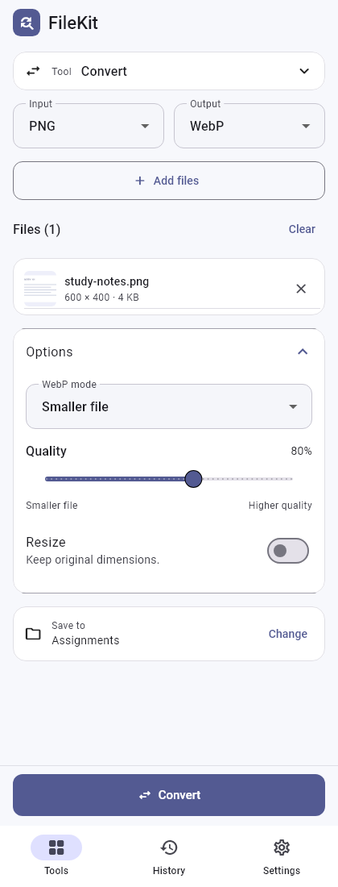
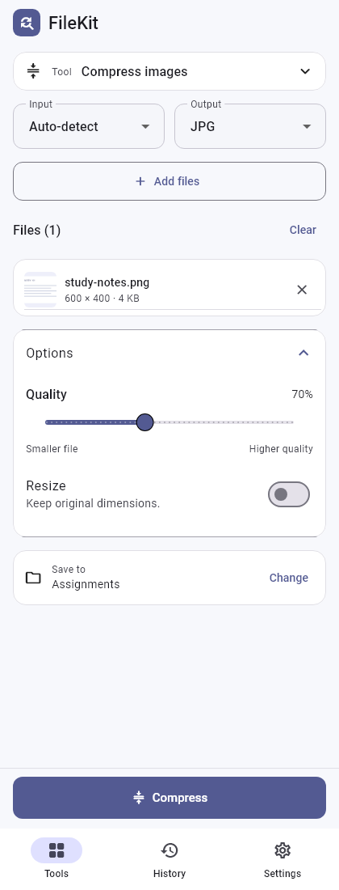
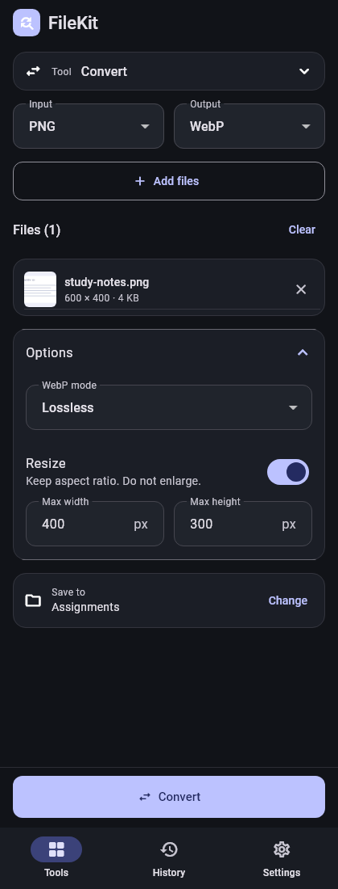
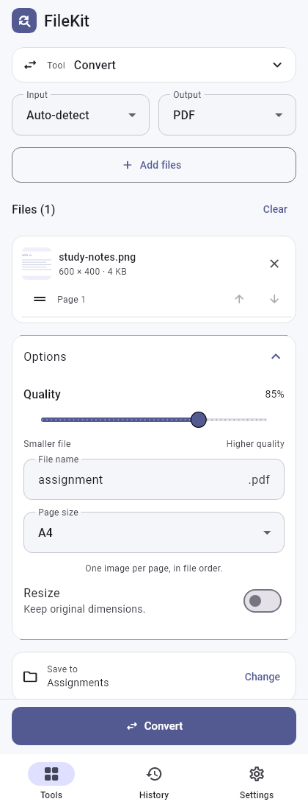
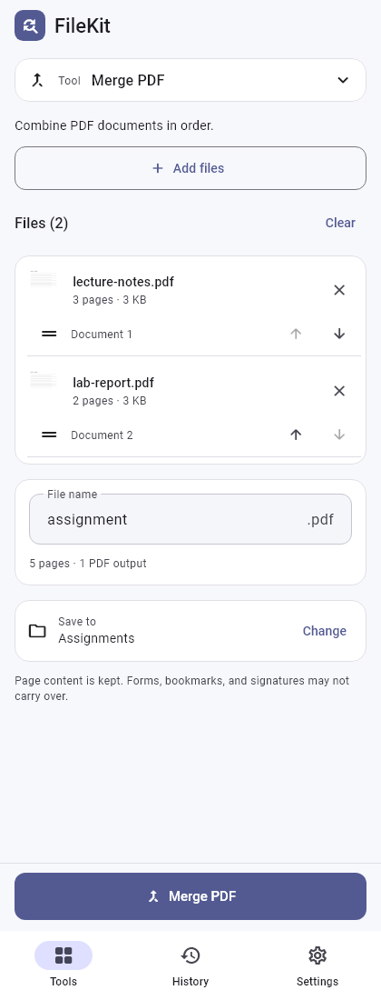
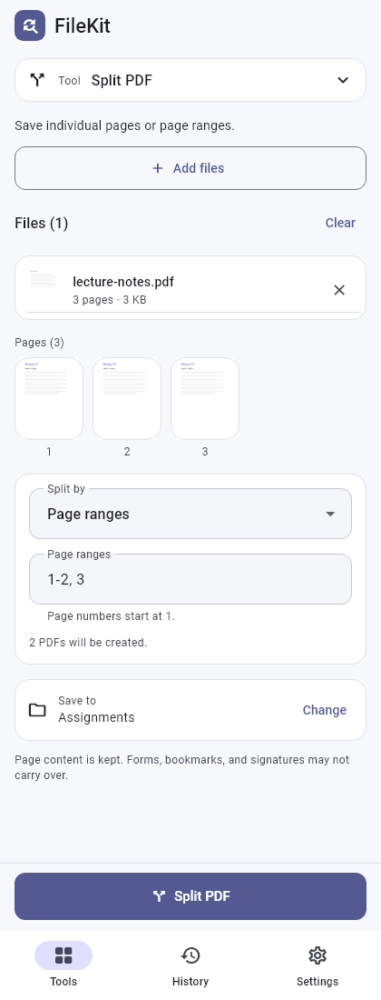
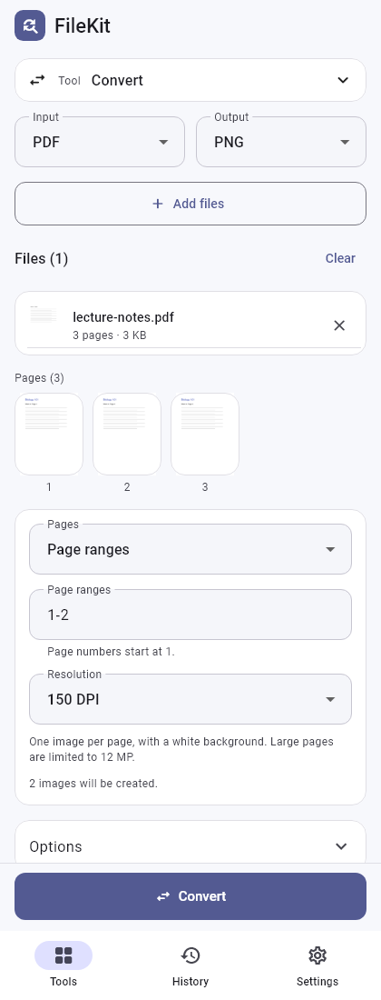
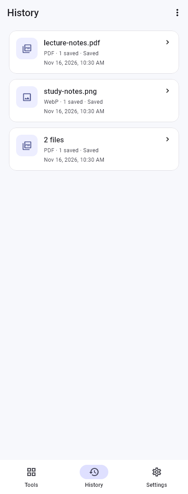
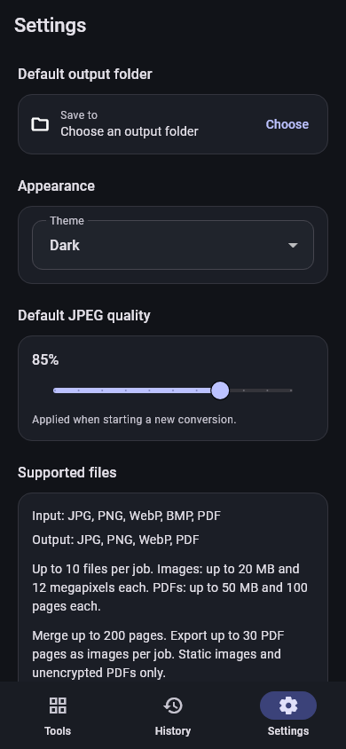

# FileKit

FileKit is a Flutter Android app for converting images and preparing PDFs. Convert, compress, or resize study notes and photos, combine assignment pages, and save results to a folder you choose. Processing runs on your device, and original files stay unchanged.

## Features

- Convert PNG, JPG/JPEG, and WebP images; import BMP with Auto-detect.
- Compress images, preserve supported transparency, and resize without stretching or upscaling.
- Create PDFs from images, merge PDFs, or split them by page or range.
- Export PDF pages as PNG or JPG at 150 or 300 DPI.
- Choose an output folder, open or share saved files, and review job history.
- Use Light, Dark, or System appearance. No account or conversion server is required.

## Screenshots

| Convert images | Compress images | Resize images |
| :---: | :---: | :---: |
|  |  |  |

| Images to PDF | Merge PDFs | Split a PDF |
| :---: | :---: | :---: |
|  |  |  |

| PDF pages to images | History | Dark mode |
| :---: | :---: | :---: |
|  |  |  |

*Renders of the app's Flutter interface with sample files, not physical-device screenshots.*

## Build and run

Requirements:

- Flutter **3.50.0** / Dart **3.14.0** and JDK **21**.
- Android SDK **36**, Build Tools **36.0.0**, and NDK **28.2.13676358**.
- An Android device or emulator running **Android 7.0 / API 24+**.

Configure Flutter and your Android SDK, then check `flutter doctor -v`. If Flutter selects another Java installation, set it with `flutter config --jdk-dir "<path-to-jdk-21>"`. Accept SDK licenses with `flutter doctor --android-licenses`.

From the repository root:

```sh
flutter pub get
flutter run
```

The first build downloads dependencies and may take several minutes. Gradle's wrapper and the dependency lockfile are included.

### Build and install an APK

From the repository root, build for an ARM64 Android phone:

```sh
flutter build apk --release --target-platform android-arm64 --split-per-abi
adb install -r build/app/outputs/flutter-apk/app-arm64-v8a-release.apk
```

Enable USB debugging and connect the phone before using `adb`, or copy the APK to the phone and open it to install. For an emulator/debug build, use `flutter build apk --debug`. Builds currently use a development signing key; configure your own signing key before publishing.

## Using FileKit

1. Choose a tool. For conversion, select the input and output formats, then tap **Add files**.
2. Adjust options or PDF page ranges. Reorder files for merging or image-to-PDF, and select your **Save to** folder.
3. Tap the action button, then **Open file** or **Share**. Saved jobs appear in **History**; clearing history keeps exported files.

Static images and unprotected PDFs are supported. Re-encoding may produce a larger file, and advanced PDF forms, bookmarks, or signatures may not survive page operations. Real Android folder-provider and sharing checks remain part of device verification.
